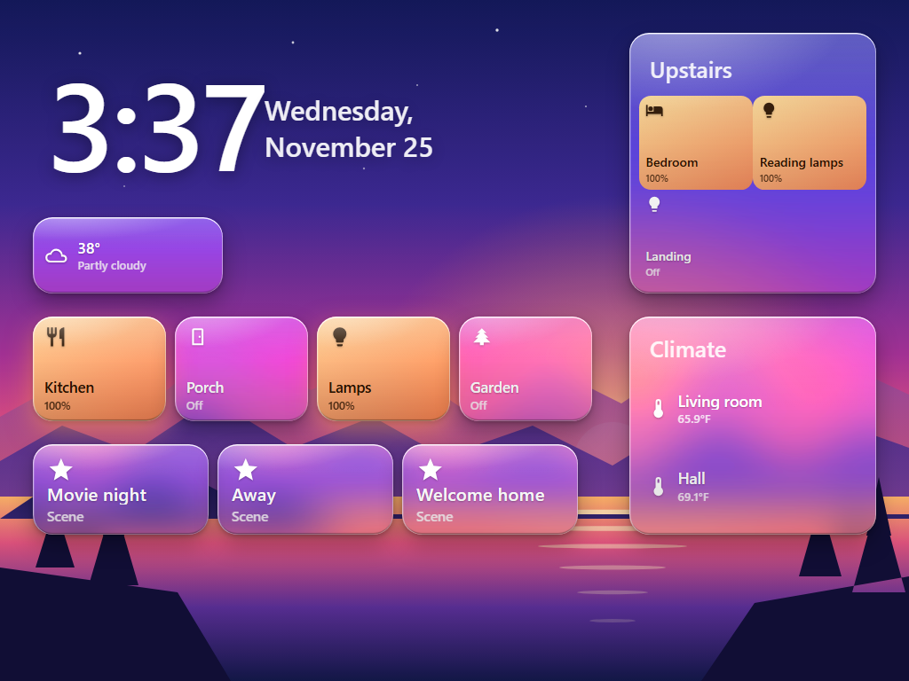
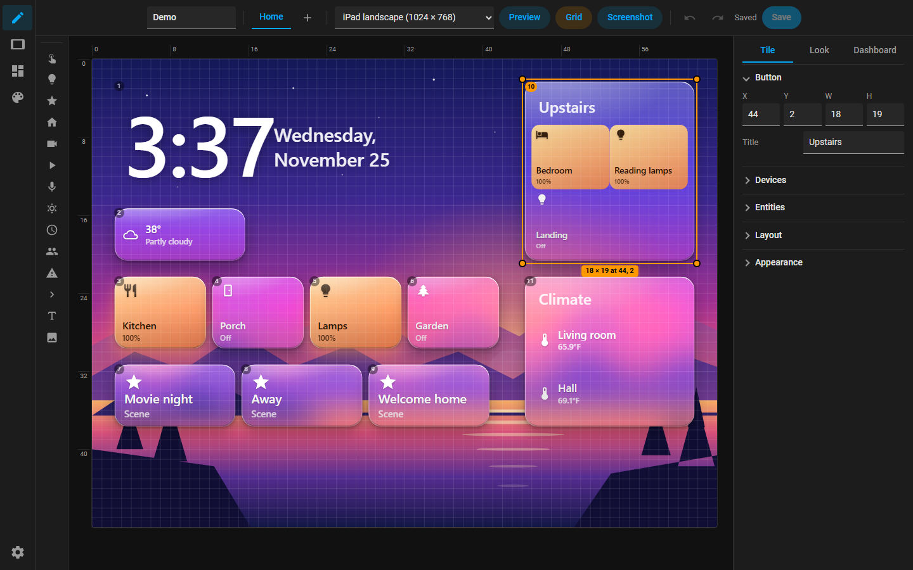
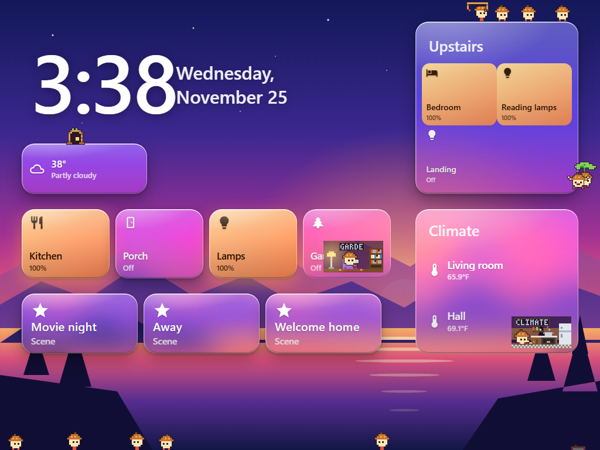

# Daedalus

## Description

Daedalus is a wall-tablet dashboard system for Home Assistant. Dashboards are designed on a grid in a Home Assistant
add-on and displayed by a tablet app.



## Two parts

**Daedalus Workshop** is a Home Assistant add-on. It holds the designs, the list of tablets, and the editor.

**Daedalus Panel** is the iPad app. It finds the Workshop on the network, waits for approval, then draws the
design it is given. It keeps a copy, so it starts without the server.

Tablets never hold a Home Assistant token. They reach Home Assistant through the Workshop with their own key,
and the key stops working when the tablet is removed.

## Workshop



- Drag and resize tiles on a snap grid. The sheet is the real tablet renderer with live house state.
- Tiles: clock, weather, people, alerts, light or switch, scene, room, media, camera, page link, text, picture,
  multi-device button, voice assistant.
- Look: background picture, tile fill, corners, glass.
- One design can be fitted to tablets of another size or orientation.
- Save, and tablets using that design update within a few seconds.

## Overlays

Thirty animated overlays run on top of a dashboard and use the tiles as terrain: snow that settles on tiles,
koi in the gaps, vines, a goose that steals tiles, a tank battle, and others.



Above: Walkers. They drop from a hatch and try to reach the gate, building stairs and digging through tiles on the way.

## Install

### Workshop

1. In Home Assistant, open **Settings > Add-ons > Add-on Store > Repositories**.
2. Add `https://github.com/synssins/Daedalus`.
3. Install **Daedalus Workshop** and start it.
4. Open **Daedalus** in the sidebar.

Runs on amd64 and aarch64. It uses the host network on port 8722 and advertises `_daedalus._tcp` over mDNS.

### Panel

The app is built for jailbroken iPads on iPadOS 15 (tested on iPad Air 2). It is not in the App Store.

1. Push to GitHub. The `build` workflow compiles the app on a macOS runner and uploads `DaedalusPanel.app.tar`.
2. Put an SSH key for the tablet's `mobile` user at `~/.ssh/ipad_panel_ed25519`.
3. Run:

```powershell
.\deploy.ps1 -Ip <tablet address>
```

The script downloads the newest build, installs it over SSH and starts it. Use `-WebOnly` to send only the `web`
folder.

## Use

1. Open the Panel app on a tablet on the same network. It shows under **Tablets** as waiting.
2. Press **Approve** and choose a design for it.
3. Open the design, change it, press **Save**.

Updating the add-on also updates the drawing engine on every tablet. The app itself only changes for native
features.

## Develop

Run the Workshop on a PC against a Home Assistant instance:

```sh
cd addon
HA_URL=http://homeassistant.local:8123 HA_TOKEN=<long-lived token> DAEDALUS_MDNS=0 \
  uv run --with-requirements requirements.txt python -m server
```

Then open `http://127.0.0.1:8722/`. `DAEDALUS_MDNS=0` keeps a development copy from drawing tablets away from
the real one.

- Store tests: `python addon/tests/test_store.py`
- Overlay test page: open `web/fx-demo.html?kind=walkers` in a browser.

## Layout

| Path | Description |
| --- | --- |
| `Sources/` | The iPad app shell (Swift, WKWebView) |
| `web/` | The renderer: tiles, overlays, assistant |
| `addon/server/` | The Workshop server (Python, aiohttp) |
| `addon/studio/` | The Workshop page and editor |
| `addon/renderer/` | The copy of `web/` the add-on serves |
