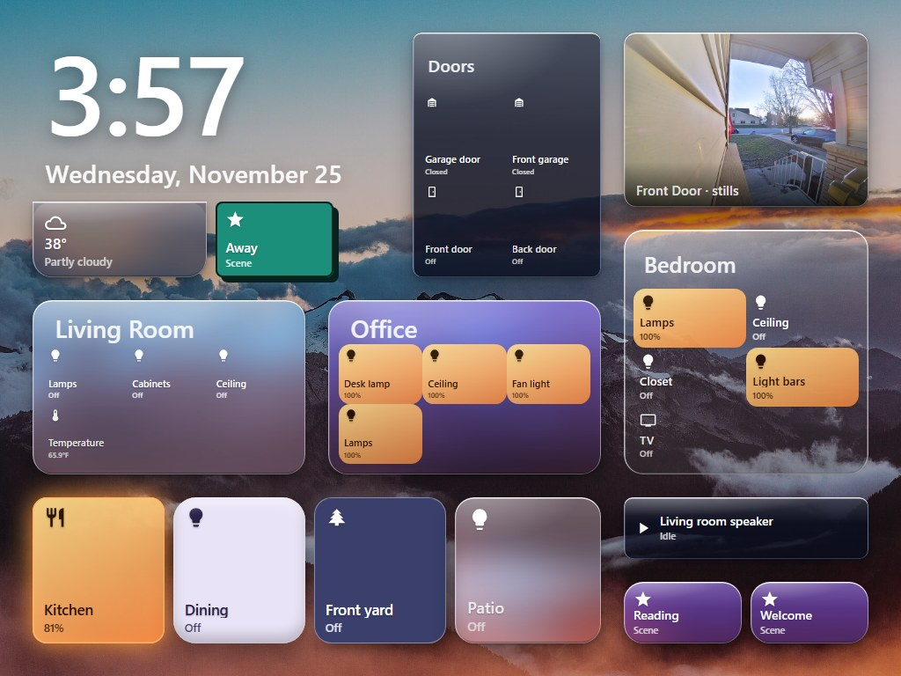
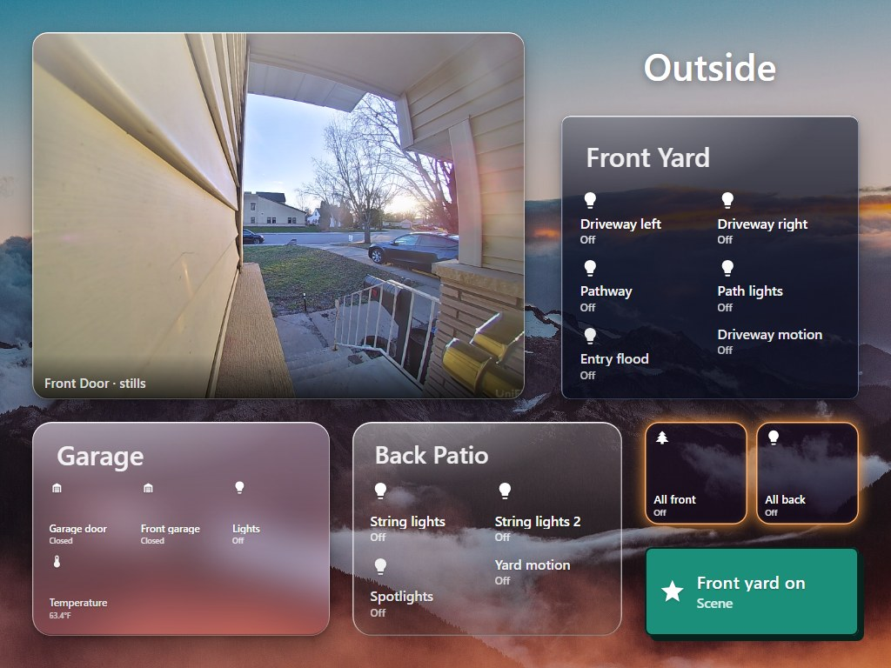
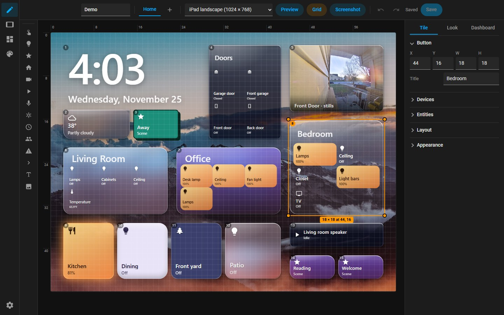
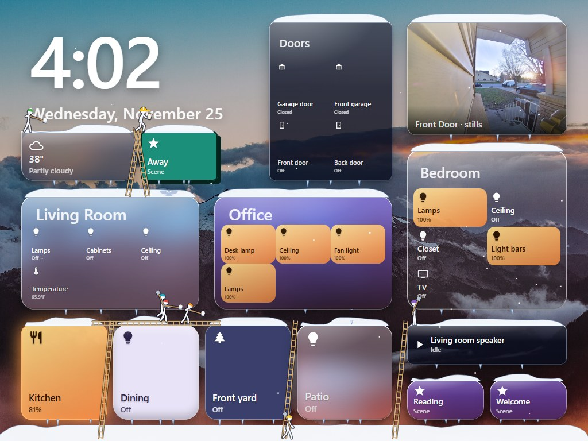
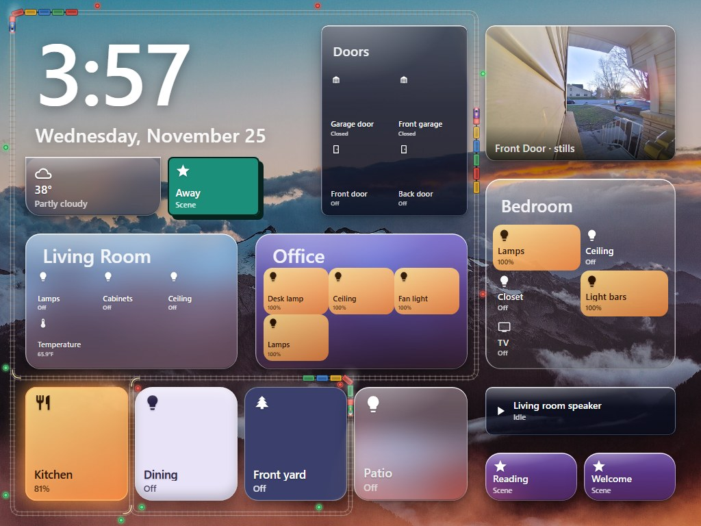
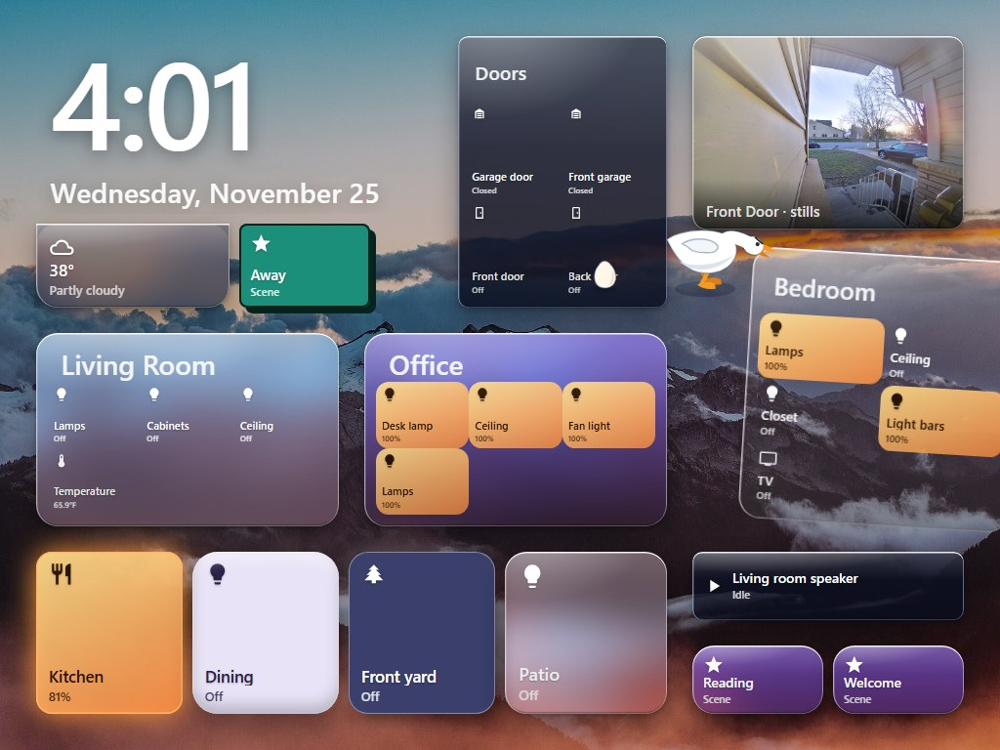
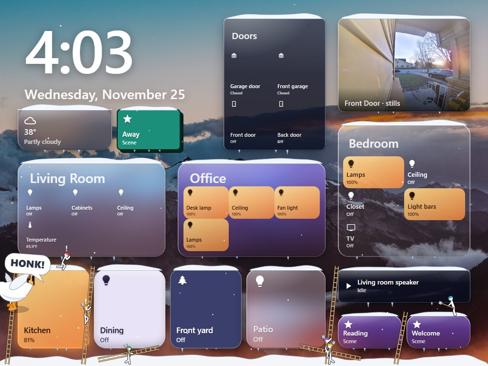
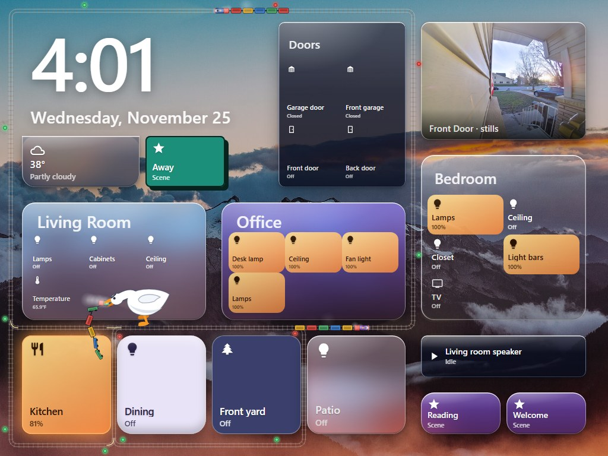
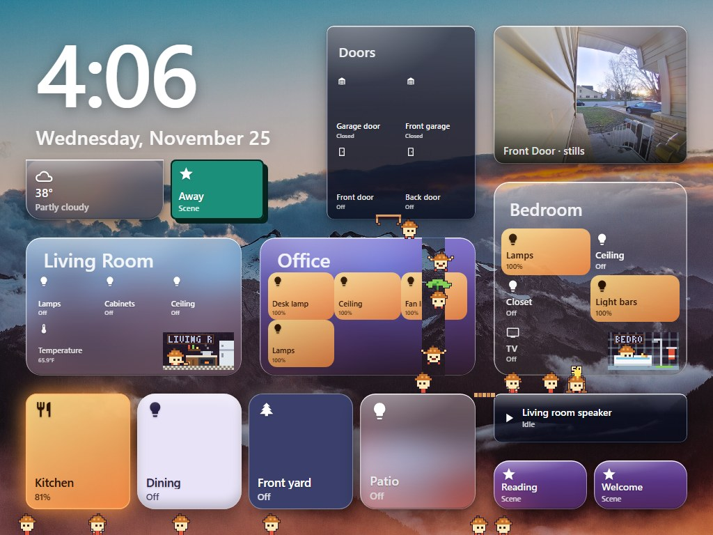

# Daedalus

## Description

Daedalus is a wall-tablet dashboard system for Home Assistant. It has two components:

- **Daedalus Workshop** is a Home Assistant add-on. It stores dashboard designs, manages registered tablets, and
  provides the dashboard editor.
- **Daedalus Panel** is a tablet app. It discovers the Workshop over mDNS, registers with it, and renders the
  assigned design. The design is cached on the tablet, so the app starts when the Workshop is unreachable.

Tablets do not store a Home Assistant token. Each tablet is issued its own key and connects to Home Assistant
through the Workshop. Removing a tablet in the Workshop revokes its key.



## Features

### Dashboards

Tiles are placed freely on the grid and can be grouped by room or by function. A dashboard has one or more pages.
Each tile can use the theme or its own look: fill, gradient, transparency, frosted glass, border, corner radius,
shadow style.



### Editor



- Snap-grid layout with drag and resize.
- Live preview that uses the tablet renderer and current Home Assistant state.
- Tile types: clock, weather, people, alerts, light or switch, scene, room, media, camera, page link, text, picture,
  multi-device button, voice assistant.
- Theme settings: background image, tile fill, corner radius, glass effect.
- Designs can be fitted to other screen sizes and orientations.
- Saved changes are pushed to tablets within a few seconds.

### Overlays

30 animated overlays are included. An overlay is drawn over the dashboard and interacts with the tile layout.
Examples: snow, rain, fireflies, koi, vines, goose, tank battle, walkers.

| | |
| --- | --- |
|  Snow Crew |  Train |
|  Goose taking a tile |  Goose chasing the Snow Crew |
|  Goose derailing a train |  Walkers |

## Installation

### Daedalus Workshop

1. In Home Assistant, open **Settings > Add-ons > Add-on Store > Repositories**.
2. Add `https://github.com/synssins/Daedalus`.
3. Install **Daedalus Workshop** and start it.
4. Open **Daedalus** in the sidebar.

Supported architectures: amd64, aarch64. The add-on uses the host network on port 8722 and is advertised over mDNS
as `_daedalus._tcp`.

### Daedalus Panel

The app is not distributed through the App Store. The current build targets iPadOS 15 and is installed over SSH on
a jailbroken device.

1. Push the repository to GitHub. The `build` workflow compiles the app and uploads `DaedalusPanel.app.tar` as an
   artifact.
2. Place the SSH private key for the tablet's `mobile` user at `~/.ssh/ipad_panel_ed25519`.
3. Run the deploy script:

```powershell
.\deploy.ps1 -Ip <tablet address>
```

`deploy.ps1` downloads the latest build artifact, installs it over SSH, and launches the app. The `-WebOnly` switch
copies only the `web` folder.

## Usage

1. Open Daedalus Panel on a tablet on the same network as Home Assistant. The tablet is listed under **Tablets**
   as waiting.
2. Select **Approve** and assign a design.
3. Open the design in the editor, make changes, and select **Save**.

The Workshop also serves the rendering engine to tablets. Updating the add-on updates the engine on all tablets.
The app requires reinstallation only for changes to native code.

## Development

Run the Workshop locally against a Home Assistant instance:

```sh
cd addon
HA_URL=http://homeassistant.local:8123 HA_TOKEN=<long-lived token> DAEDALUS_MDNS=0 \
  uv run --with-requirements requirements.txt python -m server
```

The editor is served at `http://127.0.0.1:8722/`. `DAEDALUS_MDNS=0` disables mDNS advertising, so tablets do not
connect to the development instance.

- Store tests: `python addon/tests/test_store.py`
- Overlay test page: `web/fx-demo.html?kind=walkers`

## Repository layout

| Path | Description |
| --- | --- |
| `Sources/` | Tablet app shell (Swift, WKWebView) |
| `web/` | Renderer: tiles, overlays, voice assistant |
| `addon/server/` | Workshop server (Python, aiohttp) |
| `addon/studio/` | Workshop page and editor |
| `addon/renderer/` | Copy of `web/` served by the add-on |

## Credits

Background photo in the screenshots: "Snowy mountains at dusk" by Nitish Meena, CC0, via Wikimedia Commons.
